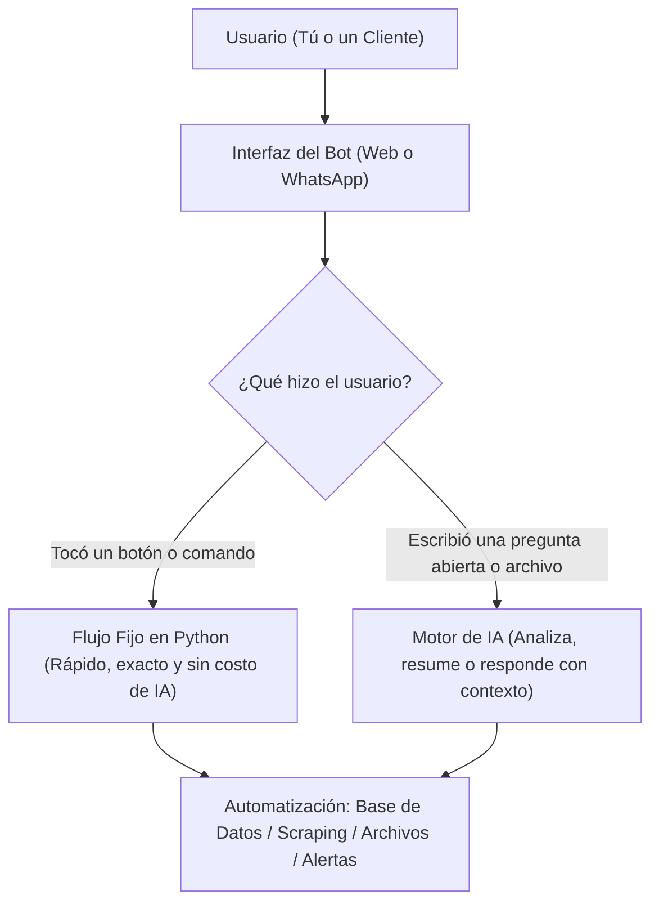

# Guía Paso a Paso: Selección y Diseño de tu Bot en Python

Esta guía está dividida en **4 partes cortas** para que puedas revisarla con calma y definir exactamente qué vamos a construir.

---

## Parte 1: ¿Qué tipo de Bot queremos? (El Enfoque Híbrido)

Ya definimos dos bases muy importantes:
1. **Lenguaje:** **Python** (el mejor para automatización, manejo de datos e Inteligencia Artificial).
2. **Comportamiento:** **Bot Híbrido (Menús + IA)**.

### ¿Cómo funciona un Bot Híbrido?
En lugar de dejar que la IA haga todo sin control (lo que a veces genera errores o costos altos), dividimos el trabajo en dos:

> **Ventaja clave:** Los botones garantizan que las tareas importantes (guardar datos, generar reportes, consultar estados) nunca fallen, mientras que la IA aporta flexibilidad cuando se necesita analizar texto o responder dudas abiertas.

---

## Parte 2: Las 4 Opciones de Proyecto (Automatización y Datos)

Dentro de la categoría de **Automatización, Procesos y Monitoreo**, existen 4 caminos principales. Revisa cada uno para ver cuál se adapta mejor a tu idea:

### Opción 3A: Bot Rastreador y de Alertas (Web Scraping / Monitoreo)
* **¿Qué hace?** Vigila páginas web, precios de la competencia, portales de noticias, inventarios o APIs cada cierto tiempo de forma automática.
* **¿Cómo interactúas con él?**
  * **Automático:** Te envía una alerta cuando detecta un cambio (ej. *"Bajó de precio X producto"* o *"Salió una nueva publicación"*).
  * **Botones:** `[Ver enlace]`, `[Comparar historial]`, `[Resumir con IA]`.
  * **IA:** Puedes preguntarle *"¿Cuál ha sido la mejor oferta de esta semana según lo que recolectaste?"*.

### Opción 3B: Bot Operativo / Back-Office (Archivos, Reportes y Tareas Internas)
* **¿Qué hace?** Automatiza trabajo pesado de oficina o negocio: lee documentos (PDFs, Excel, imágenes de recibos/facturas), extrae datos, los organiza en una base de datos y genera reportes.
* **¿Cómo interactúas con él?**
  * **Menú / Botones:** `[Subir documento]`, `[Generar reporte diario]`, `[Consultar gastos/ventas]`.
  * **IA:** Extrae el texto de un documento desordenado y lo convierte en una tabla limpia, o responde preguntas como *"¿Cuánto gastamos este mes en proveedores?"*.

### Opción 3C: Bot de Negocio + Automatización de Pedidos/Citas (Clientes Externos)
* **¿Qué hace?** Atiende a usuarios o clientes, les muestra un catálogo o servicios, responde dudas y **automatiza el registro** (guarda el pedido, agenda la cita en el calendario o envía una cotización en PDF).
* **¿Cómo interactúas con él?**
  * **Menú / Botones (Cliente):** `[Ver catálogo/servicios]`, `[Cotizar]`, `[Estado de mi pedido]`.
  * **IA:** Si el cliente pregunta *"¿Qué opción me recomiendas para X necesidad?"*, la IA le asesora usando únicamente la información real de tu negocio.

### Opción 3D: Asistente Personal / Centro de Control (Productividad y Automatización)
* **¿Qué hace?** Tu propio centro de mando para programar recordatorios, guardar notas rápidas, resumir artículos/videos largos, consultar el clima/finanzas o ejecutar scripts en tu computadora/servidor.
* **¿Cómo interactúas con él?**
  * **Menú / Botones:** `[Nueva tarea]`, `[Mis pendientes de hoy]`, `[Resumir link]`.
  * **IA:** Organiza tus ideas o redacta borradores a partir de notas rápidas.

---

## Parte 3: ¿Dónde debe vivir el Bot? (Web Propia vs. WhatsApp)

Aquí comparamos las dos plataformas que te llamaron la atención para que lo evalúes con calma:

| Característica | Opción 1: Web / App Propia | Opción 2: WhatsApp |
| :--- | :--- | :--- |
| **Costo de plataforma** | **Gratis ($0)** en desarrollo local. | Requiere cuenta de Meta Business (API oficial cobra por conversación) o usar librerías no oficiales (riesgo de bloqueo de número). |
| **Facilidad para empezar** | **Muy alta.** Se programa y prueba de inmediato en tu navegador. | **Media/Baja.** Requiere configurar webhooks públicos, verificar número y permisos de Meta. |
| **Interfaz y Botones** | **Ilimitada.** Puedes tener botones, menús, tablas, gráficas, subida de archivos y panel de control. | **Limitada.** WhatsApp solo permite hasta 3 botones por mensaje o listas desplegables simples. |
| **Acceso desde el celular** | Sí (abriendo el link desde el navegador del móvil). | Sí (directo en la app de WhatsApp, ideal para notificaciones rápidas). |
| **¿Para quién es mejor?** | Para proyectos donde quieres ver paneles de datos, probar rápido o tener control visual total. | Para cuando tus usuarios son clientes externos que solo usan WhatsApp, o si necesitas alertas urgentes en tu chat. |

> **Mi recomendación técnica ("Cerebro Único"):**
> Podemos crear el **Cerebro del Bot en Python (Backend con FastAPI)** separado de la pantalla.
> 1. **Fase 1:** Lo conectamos primero a una **Web Propia** (para construir y probar toda la lógica, botones e IA gratis y rápido).
> 2. **Fase 2:** Cuando el cerebro ya funcione al 100%, le conectamos **WhatsApp** como un canal extra si lo necesitas.

---

## Parte 4: Hoja de Decisión (Para avanzar a tu ritmo)

Cuando hayas revisado las partes anteriores, solo dime tus respuestas a estos **3 puntos** (o podemos ir viendo una parte a la vez):

- [ ] **1. ¿Cuál de las 4 opciones de la Parte 2 se parece más a lo que quieres?** *(3A Rastreo/Scraping, 3B Documentos/Back-office, 3C Clientes/Pedidos, 3D Asistente Personal, o una mezcla)*.
- [ ] **2. ¿Quién usará el bot principalmente?** *(Solo tú, tu equipo de trabajo, o clientes externos)*.
- [ ] **3. ¿Te parece bien empezar con la arquitectura de "Cerebro Único + Web Propia" en la Fase 1 y dejar WhatsApp para la Fase 2?**

